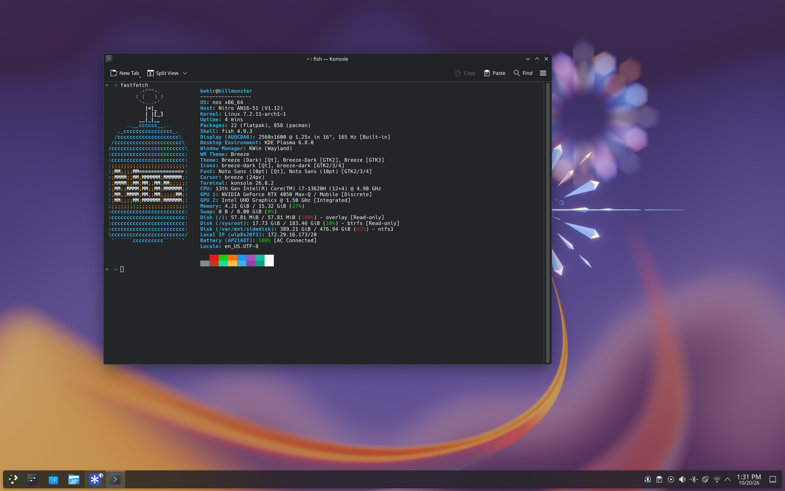

# nos

Arch Linux tabanlı, KDE Plasma masaüstüne sahip, **kişisel** bir [bootc](https://github.com/bootc-dev/bootc) imajı.

Sistem bir container imajı olarak GitHub'da build ediliyor ve bilgisayara bu imajdan kuruluyor. Güncellemeler imajın tamamı değiştirilerek geliyor; bir güncelleme sorun çıkarırsa önceki sürüme tek komutla dönülebiliyor.



## Amaç

En temel amaç: **açınca çalışan, rahat kullanılan, hafif bir makine.** Bunun için iki kural var:

1. **Hafif.** Masaüstü ve uygulamalar sadece gerçekten kullanılanlardan oluşuyor; Arch isteğe bağlı bağımlılıkları kendiliğinden kurmadığı için gereksiz paket gelmiyor. Ama aşırıya da kaçılmıyor: git, ssh, man sayfaları gibi Linux'ta normalde bulunan ve arada bir gerekebilecek araçlar yerinde.
2. **Sadece bu projenin sahibine yönelik.** İmaj tek bir kullanıcının bilgisayarları için hazırlanıyor. Şu an tek makine var: **Acer Nitro 16** dizüstü, **Intel Core i7-13620H** işlemci (tümleşik Intel grafikle), **NVIDIA RTX 4050** ekran kartı, 16 GB RAM. Açıkça başka bir donanıma özel olan paketler kurulmuyor.

İmaj iki katmandan oluşuyor:

- **`nos` (ortak kısım):** Makineden bağımsız her şey (masaüstü, uygulamalar, ayarlar); ekran ve ses kartı sürücüsü yok. Ayrıca yayınlanmıyor, sadece makine imajlarının temeli.
- **Makine imajları:** `nos` + o bilgisayarın sürücüleri ve ayarları. Kurulan ve güncellenen imaj bu.

| İmaj | İçinde | Ne için |
|---|---|---|
| `ghcr.io/ichbinbekir/nos-nitro` | `nos` + Acer Nitro 16'nın sürücüleri ve ayarları (Intel grafik, ses kartı, NVIDIA, Acer güç modları) | Dizüstü |

Makine imajları [machines/](machines/) altında tanımlı (paket listesi, servisler, ek dosyalar). Yeni bir bilgisayar için oraya bir klasör eklenir. GitHub `nos`'u bir kez build eder, sonra her makine imajını onun üzerine kurup yayınlar.

Bu iki kuralın pratikteki sonuçlarından örnekler:

- Ortak `nos` imajında ekran kartı ve ses kartı sürücüsü yok; bunlar makine imajında. İşlemci mikrokodu olarak hem `intel-ucode` hem `amd-ucode` var (açılışta işlemciye uyan uygulanır; diğeri birkaç MB yer kaplar).
- Ekran kartı sürücüsü olarak sadece NVIDIA'nın sürücüsü (`nvidia-open`) var; o da sadece `nos-nitro`'da.
- Tarayıcı olarak sadece **Helium** var (AUR'dan, imajın içinde). Başka hiçbir tarayıcı kurulmuyor.
- Güvenlik duvarı olarak firewalld yerine daha basit olan **ufw** kullanılıyor.
- Firmware paketi (`linux-firmware`) ise eksik bir şey çıkmasın diye bütün olarak kuruluyor.

**Başka biri bu imajı olduğu gibi kullanmamalı.** Örneğin AMD işlemcili ya da AMD/Intel ekran kartlı bir bilgisayarda mikrokod ve ekran kartı sürücüsü eksik kalır. Fikri beğendiysen repoyu fork'layıp paket listesini kendi donanımına göre değiştir.

## İçinde ne var

- **Masaüstü:** KDE Plasma (Wayland), SDDM giriş ekranı
- **Grafik (`nos-nitro`):** Dizüstü hibrit grafik (Intel tümleşik + NVIDIA). Masaüstü Intel ile çalışır, pil daha uzun gider. Bir uygulamayı NVIDIA ile çalıştırmak için uygulamaya sağ tıklayıp "Ayrık grafik kartıyla çalıştır" ya da terminalde `prime-run <uygulama>`; Steam oyunlarında başlatma seçeneklerine `prime-run %command%`.
- **Uygulamalar:** Konsole, Dolphin, Kate/KWrite, Ark, Spectacle, KDE Connect, Sistem İzleyici, Discover (sadece Flatpak), Btrfs Assistant (snapshot)
- **Tarayıcı:** Helium
- **Güç modları ve fanlar (`nos-nitro`):** KDE'nin pil simgesindeki güç modu seçicisi (güç tasarrufu, dengeli, performans = turbo) ve klavyedeki turbo/NitroSense tuşu (modlar sırayla döner: eco, sessiz, dengeli, performans, turbo; tuş rengi yeşil eco, beyaz sessiz, turuncu dengeli, kırmızı performans, mor turbo). Fan devri ve sıcaklıklar `sensors` ve Sistem İzleyici'de.
- **Engelli siteler:** zapret (DPI engelini aşar, açık ve kendiliğinden çalışır) ve Cloudflare WARP (ücretsiz VPN, istenince açılır). Bkz. [Engelli siteler](#engelli-siteler-zapret-ve-warp).
- **Metin kısaltmaları:** espanso (ör. `:date` yazınca bugünün tarihi). Bkz. [Metin kısaltmaları](#metin-kısaltmaları-espanso).
- **Araçlar:** fish, fastfetch, htop, unzip, git, vim (varsayılan editör), ssh istemcisi, man sayfaları, Distrobox, Podman, Python, Flatpak (Flathub hazır ekli)
- **Görünüm:** Sistem adı her yerde `nos` olarak görünür. fastfetch'te kendi logosu var: mavi bir NOS (nitro) tüpü. İsim de buradan geliyor.

Tam liste: [build_files/build.sh](build_files/build.sh) ve [build_files/aur.sh](build_files/aur.sh).

Başka bir uygulama gerekirse sırasıyla tercih edilen yollar:
1. **Flatpak** (Discover'dan ya da `flatpak install`)
2. **Distrobox** içinde herhangi bir dağıtımın paket yöneticisi
3. Sistemin parçası olması gerekiyorsa paket listesine eklenip imaj yeniden build edilir.

`pacman` ile kurulu sisteme paket kurulamaz; sistem dosyaları salt okunur.

## Kurulum

Kurulum için nos'un kendi kurulum USB'si var (Arch'ın ISO'sundan küçük, sadece kurulum için gereken araçlar). Her şey kurulum sırasında sorulur; ilk açılışta hiçbir şey sorulmaz, direkt giriş ekranı gelir.

1. BIOS/UEFI ayarlarından **Secure Boot'u kapat.** Önyükleyici ve NVIDIA sürücüsü imzalı değil. nos sadece UEFI ile açılır.
2. GitHub'da **Actions → Build installer ISO → Run workflow** ile ISO'yu üret, bitince çalışmanın **Artifacts** bölümünden `nos-installer`'ı indir (zip içinde ISO) ve USB'ye yaz (`dd`, Ventoy, Fedora Media Writer vb.). İçinde imaj olmadığı için sık yenilemek gerekmez. (Denemeler bitince ISO Releases'e de konacak.)
3. USB'den aç. Kurulum programı kendiliğinden başlar ve sırayla sorar (ok tuşları, Enter; yazarak arama):
   - klavye düzeni, internet (kablo yoksa Wi-Fi seçimi)
   - **imaj:** `nos-nitro` (Acer Nitro 16) ya da `nos`'tan türetilmiş başka bir imajın adresi
   - sistem dili, saat dilimi, bilgisayar adı, kullanıcı adı, görünen ad, şifre
   - **kişisel ayarlar (dotfiles) deposu:** bir chezmoi deposunun adresi; varsayılan bu repo (`https://github.com/ichbinbekir/nos.git`). Klasör yolu değil, deponun adresi yazılır: reponun kökündeki `.chezmoiroot` chezmoi'ye sadece [dotfiles/](dotfiles/) klasörünü kullanmasını söylüyor. Boş bırakılırsa atlanır (aşağıda "Kişisel ayarlar")
   - **disk:** bütün disk (silinir; 1 GB EFI + nos), boş alana (Windows vb. korunur) ya da var olan bir bölümün yerine. Windows'un yanına kurulunca EFI bölümü paylaşılır ve açılış menüsünde Windows da görünür. (Boş alana ve bölümün yerine kurulum henüz denenmedi; önemli verisi olan bir diskte önce yedek al.)
4. Özet gösterilir; onaydan önce diske hiçbir şey yazılmaz. Silinecek disk ya da bölüm adı yazdırılarak son kez onaylanır.
5. Kurulum diski hazırlar, imajı internetten hedef diske indirir (birkaç GB; kurulum bitince silinir), sistemi kurar, ayarları ve kullanıcıyı yazar. 4 GB RAM yeter. Bitince USB'yi çıkarıp yeniden başlat.

Kullanıcının kabuğu fish; `root` hesabı kilitli, yönetici işleri için `sudo` (kurulumdaki kullanıcı `sudo` kullanabilir). Ev dizininin otomatik snapshot'ları kurulumda ayarlanır.

**Kullanıcı grupları:** Kurulumda oluşturulan kullanıcı imajdaki listedeki gruplara eklenir: [system_files/usr/share/nos/user-groups](system_files/usr/share/nos/user-groups) (şu an `wheel`: sudo, `libvirt`: sanal makineler, `keyd`: pencereye göre tuş eşleme, `gamemode`: GameMode'un oyun ayarları). Liste kurulum USB'sinde değil imajda durur; kurulum programı onu kurduğu imajın içinden okur, imajda olmayan grup atlanır. Yeni bir grup eklemek için:

1. Dosyaya satır başına bir grup yaz (`#`'dan sonrası açıklama), commit + push. Bir sonraki imajla birlikte yeni kurulumlarda geçerli olur; USB'yi yeniden üretmek gerekmez.
2. Var olan kullanıcıya kendiliğinden verilmez, bir kez elle: `sudo usermod -aG <grup> $USER`, sonra yeniden başlat (oturumu kapatıp açmak yetmeyebilir). Hangi gruplarda olduğunu görmek: `groups`.

Gruplar dotfiles'ta değil imajda, çünkü dotfiles isteğe bağlı (atlanırsa kullanıcı `sudo` bile kullanamazdı), sadece ev klasörüne yazıyor ve grupları imajdaki programlar oluşturuyor.

**Başka bir sistemden `bootc switch` ile geçiş desteklenmiyor.** nos diskin btrfs olmasını (sıkıştırma ayarı yüzünden başka dosya sisteminde açılmaz) ve bootc'nin composefs + systemd-boot düzenini bekliyor; Fedora tabanlı sistemler (Aurora, Bluefin, Silverblue vb.) farklı bir düzen kullanıyor. Ayrıca gruplar, snapshot ayarı gibi kurulumda yapılan işler eksik kalır. nos'a geçmek için kurulum USB'siyle sıfırdan kur (önce ev klasörünü yedekle). nos imajları arasında geçiş (ör. `nos-nitro`'nun eski bir günü) sorunsuz.

Kurulum programı: [iso/airootfs/usr/local/bin/nos-install](iso/airootfs/usr/local/bin/nos-install). Varsayılan cevaplar (imaj, dil, kullanıcı adı vb.) dosyanın başında; hepsi kurulumda değiştirilebilir.

<details>
<summary>Elle kurulum (herhangi bir canlı USB ile)</summary>

Canlı USB'de `podman`'i kur (Arch ISO'da açılış satırına `cow_spacesize=16G` ekle; varsayılan 256 MB yazılabilir alan imajı indirmeye yetmiyor), hedef diski bul (`lsblk`) ve:

```
sudo podman run --rm --privileged --pid=host \
  --security-opt label=type:unconfined_t \
  -v /var/lib/containers:/var/lib/containers -v /dev:/dev \
  ghcr.io/ichbinbekir/nos-nitro:latest \
  bootc install to-disk --composefs-backend --bootloader systemd \
    --filesystem btrfs --wipe /dev/nvme0n1
```

Dosya sistemi btrfs olmalı: imaj diski zstd ile sıkıştırarak kullanıyor, başka bir dosya sistemiyle açılmaz. Bu yolla kurulunca ilk açılışta kullanıcı ve dil bilgileri sorulur.
</details>

### Sanal makinede denemek (VirtualBox)

**Kurulum ISO'suyla:** Yeni bir sanal makine oluştur (Tür: Linux / Arch Linux 64-bit; **Sistem → Anakart → "EFI'yi etkinleştir"** işaretli; en az **4 GB RAM**, 2+ işlemci, en az 40 GB disk; Ekran → VMSVGA), ISO'yu optik sürücüye tak ve aç. Kurulum gerçek bilgisayardakiyle aynı. İmaj olarak `nos-nitro` kurulabilir: sanal makinede NVIDIA kartı olmadığı için NVIDIA servisleri hata yazar, bu normal; ekran sanal makinenin kendi grafik sürücüsüyle çalışır.

## Kullanım

| İş | Komut |
|---|---|
| Güncelle (yeniden başlatınca uygulanır) | `sudo bootc upgrade` |
| Önceki sürüme dön | `sudo bootc rollback` |
| Belirli bir günün sürümüne geç (son ~15 gün) | `sudo bootc switch ghcr.io/ichbinbekir/nos-nitro:YYYYMMDD` (geri: `...nos-nitro:latest`) |
| Hangi sürümdeyim | `sudo bootc status` |
| Güncelleme var mı (indirmeden) | `sudo bootc upgrade --check` |
| Otomatik güncellemeyi bu oturumda durdur | `sudo systemctl stop nos-update.timer` |
| Süren güncelleme indirmesini kes | `sudo systemctl stop nos-update.service` |
| Otomatik güncellemeyi kalıcı kapat / aç | `sudo systemctl disable --now nos-update.timer` / `enable --now` |

İmaj her gün otomatik olarak yeniden build ediliyor; Arch paketlerindeki güncellemeler bu yolla geliyor. Sistem de güncellemeleri kendisi kontrol ediyor (açılıştan 10 dakika sonra, sonra her 6 saatte bir): yeni sürümü arka planda indirip hazırlıyor, bilgisayarı yeniden başlatmıyor. Hazırlanan sürüm bir sonraki açılışta devreye giriyor. Elle `sudo bootc upgrade` yapmak gerekmiyor; hemen kontrol etmek istersen kullanabilirsin.

### Tuş eşleme (keyd)

Tuşlar sadece belirli bir uygulamanın penceresi öndeyken değiştirilebilir. Örnek: Roblox (Sober) WASD'yi zorunlu tutuyor; ESDF ile oynamak için `~/.config/keyd/app.conf`:

```
[*sober*]
e = w
s = a
d = s
f = d
```

Sonra oturumu kapatıp aç (eşlemeleri oturum açılışında `keyd-application-mapper` başlatıyor). Köşeli parantezin içi pencere adı; araç adları küçük harfe çevirip harf ve rakam dışındaki her şeyi `-` yapıyor (`org.vinegarhq.Sober` → `org-vinegarhq-sober`), `*` herhangi bir şey demek. Pencerenin adını öğrenmek için: `keyd-application-mapper -v` (pencereler arasında geçiş yaptıkça adlarını yazar; çalışan kopyası varsa önce `pkill -f keyd-application-mapper`). Kullanıcı `keyd` grubunda olmalı (kurulum programı ekliyor). Bütün sistemde geçerli eşlemeler `/etc/keyd/` altında (bkz. `man keyd`).

Eşlemeyi oyun içinde bir tuşla geçici kapatmak (ör. sohbete yazarken) için imajda boş bir `nomap` katmanı var: o katman açıkken eşlenen tuşlar normal yazar. Örnek: `.` (nokta) açıp kapatsın. keyd tuşları ABD klavyesindeki yerlerine göre adlandırıyor; Türkçe Q'da `.` yazan tuşun adı `slash`:

```
[*sober*]
e = w
s = a
d = s
f = d
slash = toggle(nomap)
nomap.e = e
nomap.s = s
nomap.d = d
nomap.f = f
```

Açılış yazılar yerine sade bir animasyonla geçer; yazıları görmek için açılırken Esc'ye bas.

Açılışta 5 saniyelik bir menü çıkar: nos'un şu anki ve önceki sürümü, aynı EFI bölümündeyse Windows. Bekleme süresini kurulum programı ayarlıyor.

İmajda SSH sunucusu açık değil; `ssh` sadece başka makinelere bağlanmak için var.

Gece ışığı açıkken tarayıcıda ya da VS Code gibi uygulamalarda renkler gidip geliyorsa: Sistem Ayarları → Ekran'da renk doğruluğu/verimlilik seçeneğini "renk doğruluğu"na al. Ayar kullanıcıya ve ekrana özel; her yeni kullanıcı ve yeni ekran için bir kez yapılır.

### Metin kısaltmaları (espanso)

[espanso](https://espanso.org/) yazdığın kısaltmayı metinle değiştirir; her uygulamada çalışır. Kısaltmalar `~/.config/espanso/match/base.yml`'de, örnek:

```yaml
matches:
  - trigger: ":mail"
    replace: "ornek@ornek.com"
```

Dosya kaydedilince espanso kendisi yeniden okur. Girişte kendiliğinden açılması için bir kez: `systemctl --user enable --now espanso` (sahibinin [dotfiles](dotfiles/)'ı bunu ve kısaltmaları kendisi getiriyor). Wayland'de klavye düzeni `~/.config/espanso/config/default.yml`'de yazılı olmalı (`keyboard_layout: {layout: "tr"}`). Geçici kapatıp açmak: `espanso cmd toggle`; durum: `espanso status`.

### Engelli siteler (zapret ve WARP)

**zapret** internet sağlayıcısının engelini (DPI) bağlantıyı yavaşlatmadan aşar; VPN değildir, trafik yine doğrudan gider. Açık geliyor ve sadece engelli görünen sitelere uygulanıyor: listedekilere (Discord, Roblox: `/etc/zapret/ipset/zapret-hosts-user.txt`) ve açılmadığını kendisi fark ettiklerine (`zapret-hosts-auto.txt`). Hangi yöntemin işe yaradığı internet sağlayıcısına göre değişir. Hazır ayar çalışmazsa uygun olanı bulmak için:

1. `sudo /opt/zapret/blockcheck.sh` (soruları varsayılanla geç, alan adına engelli bir site yaz, ör. `discord.com`; birkaç dakika sürer).
2. Sonda "summary" altında çalışan seçenekleri (`nfqws ... --dpi-desync=...`) `/etc/zapret/config`'teki `NFQWS_OPT`'a yaz (`sudoedit /etc/zapret/config`).
3. `sudo systemctl restart zapret`.

Listeye site eklemek: `sudoedit /etc/zapret/ipset/zapret-hosts-user.txt` (satır başına bir alan adı), sonra `sudo systemctl restart zapret`. Kapatmak: `sudo systemctl disable --now zapret`.

**Cloudflare WARP** ücretsiz VPN; hesap gerekmiyor. Bütün trafiği Cloudflare üzerinden geçirir (bölge seçilemez, en yakın sunucuya bağlanır). zapret işe yaramadığında ya da oyun gibi her bağlantının aşması gerektiğinde kullanılır. Arka plan servisi (`warp-svc`) açık gelir; VPN sen bağlanana kadar bağlanmaz. Arayüzü menüde "Cloudflare One Client" (sistem tepsisinde simge); terminalden:

| İş | Komut |
|---|---|
| Servisi kapat / yeniden aç | `sudo systemctl disable --now warp-svc` / `sudo systemctl enable --now warp-svc` |
| Tepsi simgesi her girişte açılsın / açılmasın | `systemctl --user enable --now warp-taskbar` / `systemctl --user disable --now warp-taskbar` |
| İlk kez (bir kez) | `warp-cli registration new` |
| Bağlan / bağlantıyı kes | `warp-cli connect` / `warp-cli disconnect` |
| Durum | `warp-cli status` |

Bağlıyken bilgisayar kapatılırsa WARP açılışta yeniden bağlanır.

### Kişisel ayarlar (dotfiles)

Ev klasörüne giden ayarlar (ör. keyd eşlemesi) bu reponun [dotfiles/](dotfiles/) klasöründe, [chezmoi](https://www.chezmoi.io/) biçiminde (`dot_config/...` → `~/.config/...`). Kurulum programı depoyu `~/.local/share/chezmoi`'ye indirip ayarları ev klasörüne yazar; sonrası chezmoi ile:

| İş | Komut |
|---|---|
| Repodaki son ayarları ev klasörüne al | `chezmoi update` |
| Ev klasöründe değiştirdiğin ayarları repoya al | `chezmoi re-add`, sonra `chezmoi git -- commit -am "..."` ve `chezmoi git push` |
| Yeni bir ayar dosyasını takibe al | `chezmoi add ~/.config/...` |
| Neler değişecek, önce gör | `chezmoi diff` |

Depo kurulumda herkese açık adresten (HTTPS) iner; push için bir kez SSH adresine çevir: `chezmoi git -- remote set-url origin git@github.com:ichbinbekir/nos.git`. Şifre, SSH anahtarı gibi gizli bilgiler repoya konmaz. Kurulum programıyla kurulmamış bir sistemde: `chezmoi init --apply https://github.com/ichbinbekir/nos.git`.

### Ev dizini snapshot'ları

Ev dizininin (`/home`; dosyalar ve `~/.config` içindeki bütün ayarlar) btrfs snapshot'ı [snapper](http://snapper.io/) ile günde bir otomatik alınıyor (bilgisayar o an kapalıysa açılışta): son 3 gün ve son 2 hafta saklanıyor, eskileri kendiliğinden siliniyor. Yanlışlıkla silinen bir dosyayı ya da bozulan bir ayarı geri almak için:

- **Btrfs Assistant** uygulamasından (menüde): Snapper sekmesinde snapshot'ları listeler, farkları gösterir, geri yükler.
- Ya da dosya yöneticisinde `/home/.snapshots/<numara>/snapshot/` içinden eski kopyayı alarak.

| İş | Komut |
|---|---|
| Elle snapshot al | `snapper -c home create -d "açıklama"` |
| Snapshot'ları listele | `snapper -c home list` |

Sistem dosyaları için snapshot gerekmiyor; onlar salt okunur ve `sudo bootc rollback` ile önceki sürüme dönülüyor.

Snapshot yedek değildir: aynı diskte durur. Disk bozulursa snapshot'lar da gider; önemli dosyaların ayrıca başka bir yerde yedeği olmalı. Büyük bir dosya silindiğinde yer, o dosyayı içeren en eski snapshot silinince (en geç 2 hafta) açılır.

Snapshot'a girmesini istemediğin büyük bir klasörü (ör. oyunlar) ayrı bir btrfs alt birimi yapabilirsin: `btrfs subvolume create ~/Oyunlar`. Alt birimin içindekiler ana snapshot'lara dahil edilmez.

## İmza doğrulama

İmajlar [cosign](https://github.com/sigstore/cosign) ile imzalanıyor. Doğrulamak için:

```
cosign verify --key cosign.pub ghcr.io/ichbinbekir/nos-nitro:latest
```

Kurulu sistem de güncellemeleri bu anahtarla doğruluyor: `nos-nitro` imajı bu anahtarla imzalı değilse güncelleme reddedilir (`/etc/containers/policy.json`). Diğer imajlar (Distrobox, podman) bundan etkilenmez.

## Lisans

[MIT](LICENSE). İstisnalar: [build_files/bootc/](build_files/bootc/) ve Justfile'daki `rechunk` tarifi Apache-2.0, [iso/](iso/) profili (Arch'ın archiso `releng` profilinden) GPL-3.0-or-later ile, alındıkları projelerin lisansıyla kalıyor.

## Teşekkürler

- [bootcrew/mono](https://github.com/bootcrew/mono): Arch Linux'u bootc ile çalıştırma yöntemi. [build_files/bootc/](build_files/bootc/) altındaki betikler oradan alındı (Apache-2.0).
- [ublue-os/image-template](https://github.com/ublue-os/image-template): Repo düzeni ve build süreci.
