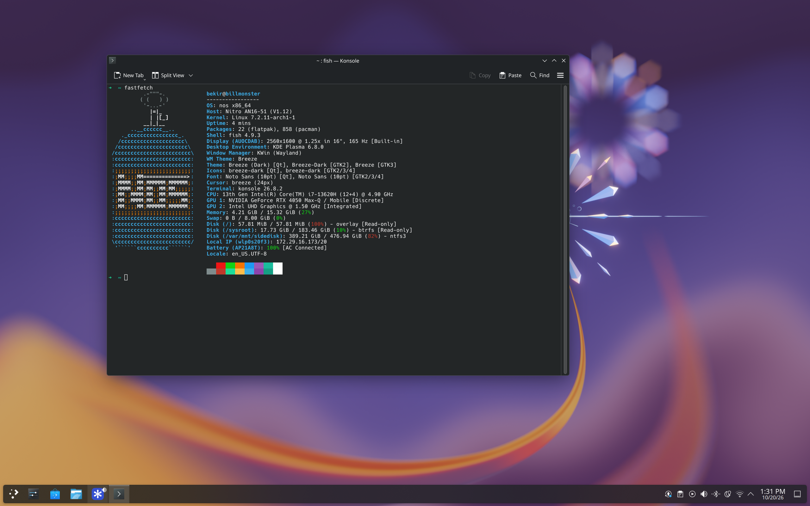

# nos

Arch Linux tabanlı, KDE Plasma masaüstüne sahip, **kişisel** bir [bootc](https://github.com/bootc-dev/bootc) imajı.

Sistem bir container imajı olarak GitHub'da build ediliyor ve bilgisayara bu imajdan kuruluyor. Güncellemeler imajın tamamı değiştirilerek geliyor; bir güncelleme sorun çıkarırsa önceki sürüme tek komutla dönülebiliyor.



## Amaç

En temel amaç: **açınca çalışan, rahat kullanılan, hafif bir makine.** Bunun için iki kural var:

1. **Hafif.** Masaüstü ve uygulamalar sadece gerçekten kullanılanlardan oluşuyor; Arch isteğe bağlı bağımlılıkları kendiliğinden kurmadığı için gereksiz paket gelmiyor. Ama aşırıya da kaçılmıyor: git, ssh, man sayfaları gibi Linux'ta normalde bulunan ve arada bir gerekebilecek araçlar yerinde.
2. **Sadece bu projenin sahibine yönelik.** İmaj tek bir bilgisayar ve tek bir kullanıcı için hazırlanıyor: **Acer Nitro 16** dizüstü, **Intel Core i7-13620H** işlemci (tümleşik Intel grafikle), **NVIDIA RTX 4050** ekran kartı, 16 GB RAM. Açıkça başka bir donanıma özel olan paketler kurulmuyor.

Bu iki kuralın pratikteki sonuçlarından örnekler:

- İşlemci mikrokodu olarak sadece `intel-ucode` var, `amd-ucode` yok.
- Ekran kartı sürücüsü olarak sadece NVIDIA'nın sürücüsü (`nvidia-open`) var.
- Tarayıcı olarak sadece **Helium** var (AUR'dan, imajın içinde). Başka hiçbir tarayıcı kurulmuyor.
- Güvenlik duvarı olarak firewalld yerine daha basit olan **ufw** kullanılıyor.
- Firmware paketi (`linux-firmware`) ise eksik bir şey çıkmasın diye bütün olarak kuruluyor.

**Başka biri bu imajı olduğu gibi kullanmamalı.** Örneğin AMD işlemcili ya da AMD/Intel ekran kartlı bir bilgisayarda mikrokod ve ekran kartı sürücüsü eksik kalır. Fikri beğendiysen repoyu fork'layıp paket listesini kendi donanımına göre değiştir.

## İçinde ne var

- **Masaüstü:** KDE Plasma (Wayland), SDDM giriş ekranı
- **Grafik:** Dizüstü hibrit grafik (Intel tümleşik + NVIDIA). Masaüstü Intel ile çalışır, pil daha uzun gider. Bir uygulamayı NVIDIA ile çalıştırmak için uygulamaya sağ tıklayıp "Ayrık grafik kartıyla çalıştır" ya da terminalde `prime-run <uygulama>`; Steam oyunlarında başlatma seçeneklerine `prime-run %command%`.
- **Uygulamalar:** Konsole, Dolphin, Kate/KWrite, Gwenview, Ark, Spectacle, KDE Connect, Sistem İzleyici, Discover (sadece Flatpak), Btrfs Assistant (snapshot)
- **Tarayıcı:** Helium
- **Araçlar:** fish, fastfetch, htop, unzip, git, vim (varsayılan editör), ssh istemcisi, man sayfaları, Distrobox, Podman, Python, Flatpak (Flathub hazır ekli)
- **Görünüm:** Sistem adı her yerde `nos` olarak görünür. fastfetch'te kendi logosu var: mavi bir NOS (nitro) tüpü. İsim de buradan geliyor.

Tam liste: [build_files/build.sh](build_files/build.sh) ve [build_files/aur.sh](build_files/aur.sh).

Başka bir uygulama gerekirse sırasıyla tercih edilen yollar:
1. **Flatpak** (Discover'dan ya da `flatpak install`)
2. **Distrobox** içinde herhangi bir dağıtımın paket yöneticisi
3. Sistemin parçası olması gerekiyorsa paket listesine eklenip imaj yeniden build edilir.

`pacman` ile kurulu sisteme paket kurulamaz; sistem dosyaları salt okunur.

## Kurulum

> [!WARNING]
> Hedef diskteki her şey silinir.

1. BIOS/UEFI ayarlarından **Secure Boot'u kapat.** Önyükleyici ve NVIDIA sürücüsü imzalı değil.
2. Herhangi bir canlı USB ile bilgisayarı aç ve `podman`'i kur.
   - Arch ISO kullanıyorsan açılış menüsünde çekirdek satırının sonuna `cow_spacesize=16G` ekle. Varsayılan 256 MB yazılabilir alan imajı indirmeye yetmiyor. Bu alan RAM'den kullanılıyor.
3. Hedef diskin adını bul (`lsblk`; örnek: `/dev/nvme0n1`) ve kur:
   ```
   sudo podman run --rm --privileged --pid=host \
     --security-opt label=type:unconfined_t \
     -v /var/lib/containers:/var/lib/containers -v /dev:/dev \
     ghcr.io/ichbinbekir/nos:latest \
     bootc install to-disk --composefs-backend --bootloader systemd \
       --filesystem btrfs --wipe /dev/nvme0n1
   ```
   Dosya sistemi btrfs olmalı (`--filesystem btrfs`): imaj diski zstd ile sıkıştırarak kullanıyor, başka bir dosya sistemiyle açılmaz.
4. Yeniden başlat. İlk açılışta bir kurulum ekranı gelir ve sırayla saat dilimi, sistem dili, klavye düzeni, bilgisayar adı, kullanıcı adı, görünen ad ve şifre sorulur (ok tuşları ve Enter ile). Sonda bir özet gösterilir; "Kur" denmeden sistemde hiçbir şey değişmez. Bitince giriş ekranı açılır. Kullanıcının kabuğu fish olarak ayarlanır.

`root` hesabı kilitli; yönetici işleri için `sudo` kullanılır (ilk açılışta oluşturulan kullanıcı `sudo` kullanabilir).

### Sanal makinede denemek (VirtualBox)

1. GitHub'da **Actions → Build disk image → Run workflow** ile biçim olarak `vdi` seç ve çalıştır.
2. Bitince çalışmanın sayfasındaki **Artifacts** bölümünden `nos-vdi`'yi indir ve zip'i aç.
3. VirtualBox'ta yeni bir sanal makine oluştur:
   - Tür: Linux, sürüm: Arch Linux (64-bit)
   - Disk: "Var olan bir sanal sabit disk dosyası kullan" → `disk.vdi`
   - **Sistem → Anakart → "EFI'yi etkinleştir" işaretli olmalı.** Önyükleyici sadece EFI ile çalışıyor; işaretli değilse sistem açılmaz.
   - En az 4 GB RAM, 2 işlemci. Ekran → Grafik denetleyicisi: VMSVGA.
4. Aç. İlk açılış adımları yukarıdaki 4. adımla aynı.

Sanal makinede NVIDIA kartı olmadığı için NVIDIA sürücüsü devreye girmez; ekran VirtualBox'ın kendi grafik sürücüsüyle çalışır, masaüstü biraz yavaş olabilir. Disk 20 GB.

## Kullanım

| İş | Komut |
|---|---|
| Güncelle (yeniden başlatınca uygulanır) | `sudo bootc upgrade` |
| Önceki sürüme dön | `sudo bootc rollback` |
| Belirli bir günün sürümüne geç (son ~15 gün) | `sudo bootc switch ghcr.io/ichbinbekir/nos:YYYYMMDD` (geri: `...nos:latest`) |
| Hangi sürümdeyim | `sudo bootc status` |
| Güncelleme var mı (indirmeden) | `sudo bootc upgrade --check` |
| Otomatik güncellemeyi bu oturumda durdur | `sudo systemctl stop nos-update.timer` |
| Süren güncelleme indirmesini kes | `sudo systemctl stop nos-update.service` |
| Otomatik güncellemeyi kalıcı kapat / aç | `sudo systemctl disable --now nos-update.timer` / `enable --now` |

İmaj her gün otomatik olarak yeniden build ediliyor; Arch paketlerindeki güncellemeler bu yolla geliyor. Sistem de güncellemeleri kendisi kontrol ediyor (açılıştan 10 dakika sonra, sonra her 6 saatte bir): yeni sürümü arka planda indirip hazırlıyor, bilgisayarı yeniden başlatmıyor. Hazırlanan sürüm bir sonraki açılışta devreye giriyor. Elle `sudo bootc upgrade` yapmak gerekmiyor; hemen kontrol etmek istersen kullanabilirsin.

Açılışta 5 saniyelik bir menü çıkar: nos'un şu anki ve önceki sürümü, aynı EFI bölümündeyse Windows. Bekleme süresini ilk kurulum ekranı ayarlıyor. `bootc switch` ile gelen sistemlerde menü görünmüyorsa EFI bölümünü (`lsblk -f`'te `vfat` olan, ör. `/dev/sda2`) geçici olarak bağlayıp ayarı yaz:

```
sudo mkdir -p /run/esp
sudo mount /dev/sda2 /run/esp
sudo sed -i 's/^#\?timeout.*/timeout 5/' /run/esp/loader/loader.conf
sudo umount /run/esp
```

İmajda SSH sunucusu açık değil; `ssh` sadece başka makinelere bağlanmak için var.

Gece ışığı açıkken tarayıcıda ya da VS Code gibi uygulamalarda renkler gidip geliyorsa: Sistem Ayarları → Ekran'da renk doğruluğu/verimlilik seçeneğini "renk doğruluğu"na al. Ayar kullanıcıya ve ekrana özel; her yeni kullanıcı ve yeni ekran için bir kez yapılır.

### Ev dizini snapshot'ları

Ev dizininin (`/home`; dosyalar ve `~/.config` içindeki bütün ayarlar) btrfs snapshot'ı [snapper](http://snapper.io/) ile günde bir otomatik alınıyor (bilgisayar o an kapalıysa açılışta): son 3 gün ve son 2 hafta saklanıyor, eskileri kendiliğinden siliniyor. Yanlışlıkla silinen bir dosyayı ya da bozulan bir ayarı geri almak için:

- **Btrfs Assistant** uygulamasından (menüde): Snapper sekmesinde snapshot'ları listeler, farkları gösterir, geri yükler.
- Ya da dosya yöneticisinde `/home/.snapshots/<numara>/snapshot/` içinden eski kopyayı alarak.

| İş | Komut |
|---|---|
| Elle snapshot al | `snapper -c home create -d "açıklama"` |
| Snapshot'ları listele | `snapper -c home list` |

Sistem dosyaları için snapshot gerekmiyor; onlar salt okunur ve `sudo bootc rollback` ile önceki sürüme dönülüyor.

Snapshot yedek değildir: aynı diskte durur. Disk bozulursa snapshot'lar da gider; önemli dosyaların ayrıca başka bir yerde yedeği olmalı. Büyük bir dosya silindiğinde yer, o dosyayı içeren en eski snapshot silinince (en geç 2 hafta) açılır.

Snapshot'a girmesini istemediğin büyük bir klasörü (ör. oyunlar) ayrı bir btrfs alt birimi yapabilirsin: `btrfs subvolume create ~/Oyunlar`. Alt birimin içindekiler ana snapshot'lara dahil edilmez.

#### Başka bir sistemden `bootc switch` ile gelenler

Snapshot ayarını ilk kurulum ekranı yapıyor; `switch` ile gelen sistemlerde o ekran çalışmadığı için ayar yok. Kurmak için (disk btrfs olmalı):

1. Masaüstünden çıkış yap, `Ctrl+Alt+F3` ile metin ekranına geç ve kendi kullanıcınla gir.
2. Ev dizinini btrfs alt birimine (subvolume) çevir. Snapshot sadece alt birimlerden alınabiliyor. Dosyalar kopyalanmadan, aynı yerde kalarak taşınır (`--reflink`):
   ```
   cd /
   sudo mv /var/home /var/home.old
   sudo btrfs subvolume create /var/home
   sudo chmod 0755 /var/home
   sudo cp -a --reflink=always /var/home.old/. /var/home/
   ```
3. snapper'ı ayarla (`<kullanıcı>` yerine kendi kullanıcı adını yaz):
   ```
   sudo snapper -c home create-config /var/home
   sudo snapper -c home set-config TIMELINE_CREATE=yes TIMELINE_CLEANUP=yes \
     TIMELINE_LIMIT_HOURLY=0 TIMELINE_LIMIT_DAILY=3 TIMELINE_LIMIT_WEEKLY=2 \
     TIMELINE_LIMIT_MONTHLY=0 TIMELINE_LIMIT_YEARLY=0 \
     ALLOW_USERS=<kullanıcı> SYNC_ACL=yes
   ```
4. Yeniden başlat. Her şey yerindeyse eski kopyayı sil: `sudo rm -rf /var/home.old`

## İmza doğrulama

İmajlar [cosign](https://github.com/sigstore/cosign) ile imzalanıyor. Doğrulamak için:

```
cosign verify --key cosign.pub ghcr.io/ichbinbekir/nos:latest
```

Kurulu sistem de güncellemeleri bu anahtarla doğruluyor: `ghcr.io/ichbinbekir/nos` imajı bu anahtarla imzalı değilse güncelleme reddedilir (`/etc/containers/policy.json`). Diğer imajlar (Distrobox, podman) bundan etkilenmez.

## Lisans

[MIT](LICENSE). İstisnalar: [build_files/bootc/](build_files/bootc/) ve Justfile'daki `rechunk` tarifi, alındıkları projelerin lisansı olan Apache-2.0 ile kalıyor.

## Teşekkürler

- [bootcrew/mono](https://github.com/bootcrew/mono): Arch Linux'u bootc ile çalıştırma yöntemi. [build_files/bootc/](build_files/bootc/) altındaki betikler oradan alındı (Apache-2.0).
- [ublue-os/image-template](https://github.com/ublue-os/image-template): Repo düzeni ve build süreci.
