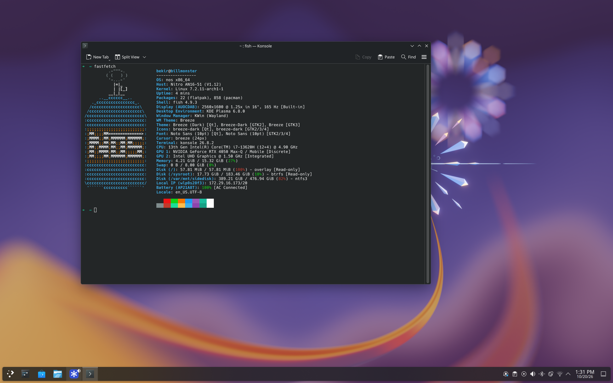

# nos

> [!WARNING]
> **Deprecated.** This project is no longer maintained. Using an image-based (bootc) system as a daily development machine turned out to be too much friction: every new tool meant either changing and rebuilding the image or setting up and maintaining a container (distrobox), and that layer kept causing problems of its own (GPU/CUDA access, editors attaching to containers, apps whose windows didn't work). I moved to a regular Arch Linux install that uses the same package selection and settings worked out here, so this repository stays as a reference. The images may stop being updated.
>
> **Kullanımdan kaldırıldı.** Bu proje artık geliştirilmiyor. İmaj tabanlı (bootc) bir sistemi her gün geliştirme yapılan bir bilgisayar olarak kullanmak fazla zahmetli oldu: her yeni araç için ya imajı değiştirip yeniden build etmek ya da bir kutu (distrobox) açıp onu yönetmek gerekiyordu, bu katman da kendi sorunlarını çıkarıyordu (ekran kartı/CUDA erişimi, editörün kutulara bağlanması, penceresi açılmayan uygulamalar). Burada belirlenen paketler ve ayarlarla normal bir Arch Linux kurulumuna geçtim; bu depo başvuru kaynağı olarak duruyor. İmajlar güncellenmeyi bırakabilir.

A **personal** [bootc](https://github.com/bootc-dev/bootc) image based on Arch Linux, with the KDE Plasma desktop.

The system is built on GitHub as a container image, and the computer is installed from that image. Updates replace the whole image; if an update causes trouble, you can go back to the previous version with a single command.



## Goal

The main goal: **a lightweight machine that works out of the box and is comfortable to use.** Two rules serve that goal:

1. **Lightweight.** The desktop and apps consist only of what is actually used; Arch does not install optional dependencies on its own, so no unneeded packages come along. But it does not go to extremes either: tools that are normally found on Linux and occasionally needed, such as git, ssh and man pages, are there.
2. **Made only for the owner of this project.** The image is built for one user's computers. Right now there is a single machine: an **Acer Nitro 16** laptop with an **Intel Core i7-13620H** CPU (with integrated Intel graphics), an **NVIDIA RTX 4050** GPU and 16 GB of RAM. Packages that are clearly meant for other hardware are not installed.

The image has two layers:

- **`nos` (shared part):** Everything that does not depend on the machine (desktop, apps, settings); no graphics or sound card drivers. It is not published on its own; it is only the base for the machine images.
- **Machine images:** `nos` + that computer's drivers and settings. This is the image that gets installed and updated.

| Image | Contents | For |
|---|---|---|
| `ghcr.io/ichbinbekir/nos-nitro` | `nos` + the Acer Nitro 16's drivers and settings (Intel graphics, sound card, NVIDIA, Acer power modes) | Laptop |

The shared image is defined under [core/](../core/) and the machine images under [machines/](../machines/); both use the same layout: a plain-text package list (`packages.txt`), services (`services.txt`) and files copied into the image (`system_files/`). For a new computer, a folder is added under `machines/`. GitHub builds `nos` once, then builds each machine image on top of it and publishes it.

Some practical consequences of these two rules:

- The shared `nos` image has no graphics or sound card drivers; those are in the machine image. For CPU microcode it has both `intel-ucode` and `amd-ucode` (the one matching the CPU is applied at boot; the other takes up a few MB).
- The only graphics driver is NVIDIA's (`nvidia-open`), and only in `nos-nitro`.
- The only browser is **Helium** (from the AUR, inside the image). No other browser is installed.
- The firewall is **ufw**, which is simpler than firewalld.
- The firmware package (`linux-firmware`), on the other hand, is installed in full so nothing ends up missing.

**Nobody else should use this image as is.** For example, on a computer with an AMD CPU or an AMD/Intel GPU, the microcode and graphics driver would be missing. If you like the idea, fork the repo and adjust the package list to your own hardware.

## What's inside

- **Desktop:** KDE Plasma (Wayland), SDDM login screen
- **Graphics (`nos-nitro`):** Laptop hybrid graphics (integrated Intel + NVIDIA). The desktop runs on Intel, so the battery lasts longer. To run an app on NVIDIA, right-click it and choose the option to run it on the dedicated graphics card, or run `prime-run <app>` in a terminal; for Steam games, add `prime-run %command%` to the launch options.
- **Apps:** Konsole, Dolphin, Kate/KWrite, Ark, Spectacle, KDE Connect, System Monitor, Discover (Flatpak only), Btrfs Assistant (snapshots)
- **Browser:** Helium
- **Power modes and fans (`nos-nitro`):** The power mode selector in KDE's battery icon (power saver, balanced, performance = turbo) and the turbo/NitroSense key on the keyboard (cycles through the modes: eco, quiet, balanced, performance, turbo; key color green for eco, white for quiet, orange for balanced, red for performance, purple for turbo). Fan speeds and temperatures are shown by `sensors` and System Monitor.
- **Blocked sites:** zapret (gets around DPI blocking, on by default and works on its own) and Cloudflare WARP (free VPN, turned on when needed). See [Blocked sites](#blocked-sites-zapret-and-warp).
- **Text expansion:** espanso (e.g. typing `:date` inserts today's date). See [Text expansion](#text-expansion-espanso).
- **Tools:** fish, fastfetch, htop, unzip, git, vim (default editor), ssh client, man pages, Distrobox, Podman, Python, Flatpak (Flathub already added)
- **Look:** The system name shows up as `nos` everywhere. fastfetch has its own logo: a blue NOS (nitrous) tank. That is also where the name comes from.

Full list: [core/packages.txt](../core/packages.txt) and [core/aur.txt](../core/aur.txt).

If another app is needed, these are the preferred ways, in order:
1. **Flatpak** (from Discover or with `flatpak install`)
2. Any distribution's package manager inside **Distrobox**
3. If it has to be part of the system, it is added to the package list and the image is rebuilt.

Packages cannot be installed on the running system with `pacman`; system files are read-only.

## Installation

nos has its own installer USB (smaller than the Arch ISO, with only the tools needed for installation). Everything is asked during installation; nothing is asked on first boot, it goes straight to the login screen.

1. **Turn off Secure Boot** in the BIOS/UEFI settings. The bootloader and the NVIDIA driver are not signed. nos only boots with UEFI.
2. On GitHub, build the ISO with **Actions → Build installer ISO → Run workflow**. When it finishes, download `nos-installer` from the run's **Artifacts** section (the ISO is inside a zip) and write it to a USB stick (`dd`, Ventoy, Fedora Media Writer, etc.). It does not contain the image, so it rarely needs to be rebuilt. (Once testing is done, the ISO will also be put on Releases.)
3. Boot from the USB. The installer starts on its own and asks, in order (arrow keys, Enter; type to search):
   - keyboard layout, internet (Wi-Fi selection if there is no cable)
   - **image:** `nos-nitro` (Acer Nitro 16) or the address of another image derived from `nos`
   - system language, time zone, computer name, user name, display name, password
   - **personal settings (dotfiles) repository:** the address of a chezmoi repository; the default is this repo (`https://github.com/ichbinbekir/nos.git`). Enter the repository's address, not a folder path: the `.chezmoiroot` file at the root of the repo tells chezmoi to use only the [dotfiles/](../dotfiles/) folder. Leave it empty to skip (see "Personal settings" below)
   - **disk:** whole disk (erased; 1 GB EFI + nos), free space (Windows etc. are kept) or in place of an existing partition. When installed next to Windows, the EFI partition is shared and Windows also shows up in the boot menu. (Installing to free space and in place of a partition has not been tested yet; back up any disk with important data first.)
4. A summary is shown; nothing is written to disk before you confirm. For the final confirmation you type the name of the disk or partition that will be erased.
5. The installer prepares the disk, downloads the image from the internet to the target disk (a few GB; deleted when installation finishes), installs the system, and writes the settings and the user. 4 GB of RAM is enough. When it finishes, remove the USB and reboot.

The user's shell is fish; the `root` account is locked, and admin tasks use `sudo` (the user created during installation can use `sudo`). Automatic snapshots of the home directory are set up during installation.

**User groups:** The user created during installation is added to the groups listed in the image: [core/system_files/usr/share/nos/user-groups](../core/system_files/usr/share/nos/user-groups) (currently `wheel`: sudo, `libvirt`: virtual machines, `keyd`: per-window key remapping, `gamemode`: GameMode's game settings). The list lives in the image, not on the installer USB; the installer reads it from inside the image it is installing, and groups that do not exist in the image are skipped. To add a new group:

1. Add one group per line to the file (anything after `#` is a comment), then commit + push. It applies to new installations with the next image; there is no need to rebuild the USB.
2. It is not given to an existing user automatically; do it once by hand: `sudo usermod -aG <group> $USER`, then reboot (logging out and back in may not be enough). To see which groups you are in: `groups`.

Groups are in the image rather than in the dotfiles, because the dotfiles are optional (if they were skipped, the user could not even use `sudo`), they only write to the home folder, and the groups are created by programs in the image.

**Switching from another system with `bootc switch` is not supported.** nos expects the disk to be btrfs (because of the compression setting, it will not boot on another file system) and bootc's composefs + systemd-boot layout; Fedora-based systems (Aurora, Bluefin, Silverblue, etc.) use a different layout. On top of that, things done during installation, such as groups and the snapshot setup, would be missing. To move to nos, do a fresh install with the installer USB (back up your home folder first). Switching between nos images (e.g. an older day of `nos-nitro`) works fine.

Installer: [iso/airootfs/usr/local/bin/nos-install](../iso/airootfs/usr/local/bin/nos-install). The default answers (image, language, user name, etc.) are at the top of the file; all of them can be changed during installation.

<details>
<summary>Manual installation (with any live USB)</summary>

Install `podman` on the live USB (on the Arch ISO, add `cow_spacesize=16G` to the boot line; the default 256 MB of writable space is not enough to download the image), find the target disk (`lsblk`) and run:

```
sudo podman run --rm --privileged --pid=host \
  --security-opt label=type:unconfined_t \
  -v /var/lib/containers:/var/lib/containers -v /dev:/dev \
  ghcr.io/ichbinbekir/nos-nitro:latest \
  bootc install to-disk --composefs-backend --bootloader systemd \
    --filesystem btrfs --wipe /dev/nvme0n1
```

The file system must be btrfs: the image uses the disk with zstd compression and will not boot with another file system. When installed this way, user and language details are asked on first boot.
</details>

### Trying it in a virtual machine (VirtualBox)

**With the installer ISO:** Create a new virtual machine (Type: Linux / Arch Linux 64-bit; **System → Motherboard → "Enable EFI"** checked; at least **4 GB of RAM**, 2+ CPUs, at least a 40 GB disk; Display → VMSVGA), attach the ISO to the optical drive and start it. Installation is the same as on a real computer. You can install `nos-nitro` as the image: since the virtual machine has no NVIDIA card, the NVIDIA services log errors, which is normal; the display works with the virtual machine's own graphics driver.

## Usage

| Task | Command |
|---|---|
| Update (applied on reboot) | `sudo bootc upgrade` |
| Go back to the previous version | `sudo bootc rollback` |
| Switch to a specific day's version (last ~15 days) | `sudo bootc switch ghcr.io/ichbinbekir/nos-nitro:YYYYMMDD` (back: `...nos-nitro:latest`) |
| Which version am I on | `sudo bootc status` |
| Is there an update (without downloading) | `sudo bootc upgrade --check` |
| Stop automatic updates for this session | `sudo systemctl stop nos-update.timer` |
| Cancel an update download in progress | `sudo systemctl stop nos-update.service` |
| Turn automatic updates off / on permanently | `sudo systemctl disable --now nos-update.timer` / `enable --now` |

The image is rebuilt automatically every day; that is how updates to Arch packages arrive. The system also checks for updates on its own (10 minutes after boot, then every 6 hours): it downloads and prepares the new version in the background and does not reboot the computer. The prepared version takes effect on the next boot. There is no need to run `sudo bootc upgrade` by hand; use it if you want to check right away.

### Key remapping (keyd)

Keys can be remapped only while a specific app's window is in front. Example: Roblox (Sober) forces WASD; to play with ESDF, put this in `~/.config/keyd/app.conf`:

```
[*sober*]
e = w
s = a
d = s
f = d
```

Then log out and back in (`keyd-application-mapper` starts the mappings at login). The text inside the square brackets is the window name; the tool lowercases names and turns everything other than letters and digits into `-` (`org.vinegarhq.Sober` → `org-vinegarhq-sober`), and `*` means anything. To find a window's name: `keyd-application-mapper -v` (it prints the names as you switch between windows; if a copy is already running, first run `pkill -f keyd-application-mapper`). The user must be in the `keyd` group (the installer adds it). System-wide mappings are under `/etc/keyd/` (see `man keyd`).

To turn the mapping off temporarily with a key in the game (e.g. while typing in chat), the image has an empty `nomap` layer: while that layer is on, the mapped keys type normally. Example: let `.` (period) toggle it. keyd names keys by their position on a US keyboard; on Turkish Q, the key that types `.` is called `slash`:

```
[*sober*]
e = w
s = a
d = s
f = d
slash = toggle(nomap)
nomap.e = e
nomap.s = s
nomap.d = d
nomap.f = f
```

Boot shows a simple animation instead of text; to see the text, press Esc while booting.

At boot a 5-second menu appears: the current and previous version of nos, and Windows if it is on the same EFI partition. The installer sets the timeout.

The SSH server is not enabled in the image; `ssh` is only there for connecting to other machines.

If colors flicker in the browser or in apps like VS Code while Night Light is on: in System Settings → Display, set the color accuracy/efficiency option to "color accuracy". The setting is per user and per display; it has to be done once for each new user and each new display.

### Text expansion (espanso)

[espanso](https://espanso.org/) replaces an abbreviation you type with text; it works in every app. Abbreviations are in `~/.config/espanso/match/base.yml`, for example:

```yaml
matches:
  - trigger: ":mail"
    replace: "example@example.com"
```

espanso reloads the file on its own when it is saved. To have it start automatically at login, run once: `systemctl --user enable --now espanso` (the owner's [dotfiles](../dotfiles/) bring this and the abbreviations along). On Wayland, the keyboard layout must be set in `~/.config/espanso/config/default.yml` (`keyboard_layout: {layout: "tr"}`). To turn it off and on temporarily: `espanso cmd toggle`; status: `espanso status`.

### Blocked sites (zapret and WARP)

**zapret** gets around the internet provider's blocking (DPI) without slowing the connection down; it is not a VPN, traffic still goes directly. It is on by default and only applies to sites that appear blocked: those on the list (Discord, Roblox: `/etc/zapret/ipset/zapret-hosts-user.txt`) and those it notices are not loading (`zapret-hosts-auto.txt`). Which method works depends on the internet provider. If the default settings do not work, to find a suitable one:

1. `sudo /opt/zapret/blockcheck.sh` (accept the defaults for the questions, enter a blocked site as the domain, e.g. `discord.com`; it takes a few minutes).
2. At the end, under "summary", copy the working options (`nfqws ... --dpi-desync=...`) into `NFQWS_OPT` in `/etc/zapret/config` (`sudoedit /etc/zapret/config`).
3. `sudo systemctl restart zapret`.

To add a site to the list: `sudoedit /etc/zapret/ipset/zapret-hosts-user.txt` (one domain per line), then `sudo systemctl restart zapret`. To turn it off: `sudo systemctl disable --now zapret`.

**Cloudflare WARP** is a free VPN; no account needed. It routes all traffic through Cloudflare (you cannot choose a region; it connects to the nearest server). Use it when zapret does not help, or when every connection needs to get through, as in games. The background service (`warp-svc`) is on by default; the VPN does not connect until you connect it. Its interface is "Cloudflare One Client" in the menu (with an icon in the system tray); from the terminal:

| Task | Command |
|---|---|
| Turn the service off / back on | `sudo systemctl disable --now warp-svc` / `sudo systemctl enable --now warp-svc` |
| Start / don't start the tray icon at every login | `systemctl --user enable --now warp-taskbar` / `systemctl --user disable --now warp-taskbar` |
| First time (once) | `warp-cli registration new` |
| Connect / disconnect | `warp-cli connect` / `warp-cli disconnect` |
| Status | `warp-cli status` |

If the computer is shut down while connected, WARP reconnects at boot.

### CPU scheduler (sched_ext)

The kernel allows changing how the CPU is shared between programs (sched_ext). **bpfland** is on at boot (the `scx_loader` service, configured in `/etc/scx_loader.toml`). The main ones:

- **bpfland:** For the desktop; keeps the app in front smooth while a heavy job runs in the background.
- **lavd:** For gaming (developed for the Steam Deck); keeps latency low and has a power-saving mode.

| Task | Command |
|---|---|
| Switch to another one (until reboot) | `scxctl switch -s lavd` |
| Which one is running | `scxctl get` |
| Turn it off (normal scheduler until reboot) | `scxctl stop` |

If a scheduler misbehaves, the kernel falls back to the normal scheduler on its own; the system does not crash. To change the one used at boot permanently: `sudoedit /etc/scx_loader.toml` (`default_sched = "scx_lavd"`); to turn it off completely: `sudo systemctl disable --now scx_loader`.

### Personal settings (dotfiles)

Settings that go into the home folder (e.g. the keyd mapping) are in this repo's [dotfiles/](../dotfiles/) folder, in [chezmoi](https://www.chezmoi.io/) format (`dot_config/...` → `~/.config/...`). The installer downloads the repository to `~/.local/share/chezmoi` and writes the settings into the home folder; after that, use chezmoi:

| Task | Command |
|---|---|
| Pull the latest settings from the repo into the home folder | `chezmoi update` |
| Bring settings you changed in the home folder into the repo | `chezmoi re-add`, then `chezmoi git -- commit -am "..."` and `chezmoi git push` |
| Start tracking a new settings file | `chezmoi add ~/.config/...` |
| See what will change first | `chezmoi diff` |

During installation the repository is downloaded from its public address (HTTPS); to push, switch it to the SSH address once: `chezmoi git -- remote set-url origin git@github.com:ichbinbekir/nos.git`. Secrets such as passwords and SSH keys are never put in the repo. On a system not installed with the installer: `chezmoi init --apply https://github.com/ichbinbekir/nos.git`.

### Home directory snapshots

A btrfs snapshot of the home directory (`/home`; files and all settings in `~/.config`) is taken automatically once a day with [snapper](http://snapper.io/) (at boot if the computer was off at the time): the last 3 days and the last 2 weeks are kept, older ones are deleted on their own. To get back an accidentally deleted file or a broken setting:

- With the **Btrfs Assistant** app (in the menu): the Snapper tab lists snapshots, shows differences and restores.
- Or by taking the old copy from `/home/.snapshots/<number>/snapshot/` in the file manager.

| Task | Command |
|---|---|
| Take a snapshot by hand | `snapper -c home create -d "description"` |
| List snapshots | `snapper -c home list` |

System files do not need snapshots; they are read-only, and `sudo bootc rollback` goes back to the previous version.

A snapshot is not a backup: it lives on the same disk. If the disk fails, the snapshots go with it; important files should also be backed up somewhere else. When a large file is deleted, its space is freed once the oldest snapshot containing it is deleted (2 weeks at most).

You can make a large folder you do not want in snapshots (e.g. games) a separate btrfs subvolume: `btrfs subvolume create ~/Games`. The contents of the subvolume are not included in the main snapshots.

## Signature verification

The images are signed with [cosign](https://github.com/sigstore/cosign). To verify:

```
cosign verify --key cosign.pub ghcr.io/ichbinbekir/nos-nitro:latest
```

The installed system also verifies updates with this key: if the `nos-nitro` image is not signed with this key, the update is rejected (`/etc/containers/policy.json`). Other images (Distrobox, podman) are not affected.

## License

[MIT](../LICENSE). Exceptions: [scripts/bootc/](../scripts/bootc/) and the `rechunk` recipe in the Justfile are Apache-2.0, and the [iso/](../iso/) profile (from Arch's archiso `releng` profile) is GPL-3.0-or-later; they keep the licenses of the projects they were taken from.

## Acknowledgements

- [bootcrew/mono](https://github.com/bootcrew/mono): The method for running Arch Linux with bootc. The scripts under [scripts/bootc/](../scripts/bootc/) were taken from there (Apache-2.0).
- [ublue-os/image-template](https://github.com/ublue-os/image-template): Repo layout and build process.
